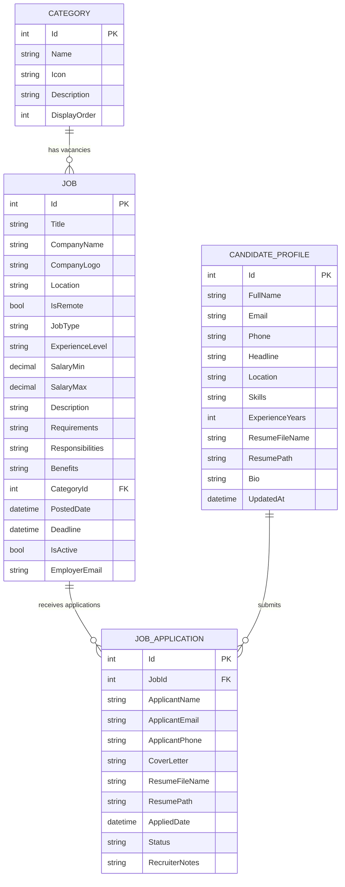

# JobHive - Online Recruitment & Job Application Portal

> **Software Developer Internship Project**  
> **Company:** CodeArrest Softwares Pvt. Ltd., Kota, Rajasthan, India  
> **Duration:** June 24, 2025 – August 23, 2025  
> **Developer:** Siddharth Sharma  

[](#tech-stack)
[](#tech-stack)
[](#database-schema)
[](#orm-and-data-access)
[](#responsive-ui)

---

## 📌 Project Overview
**JobHive** is an enterprise-grade online recruitment and job discovery web application developed during my Software Developer internship at **CodeArrest Softwares Pvt. Ltd.** The platform connects job seekers with verified employers, providing multi-role candidate management, dynamic multi-parameter vacancy discovery, and transparent application stage tracking.

---

## 🚀 Tech Stack & Core Architecture

| Layer | Technology | Details |
|---|---|---|
| **Backend Framework** | ASP.NET Core MVC | Model-View-Controller pattern, Dependency Injection, Area routing |
| **Language** | C# (.NET 8) | Strongly typed models, LINQ expressions, asynchronous handling |
| **Database Management** | Microsoft SQL Server | Normalized 3NF tables, foreign key constraints, composite indexing |
| **ORM & Data Access** | Entity Framework Core | Repository & Unit of Work patterns, Fluent API mappings, migrations |
| **Transactional Engine**| EF Core Database Transactions | ACID compliance for document submissions and stage progression |
| **Frontend / UI** | Razor Views, HTML5, CSS3, JS | Plus Jakarta Sans typography, Bootstrap 5.3, Toastr, SweetAlert2 |

---

## ⚡ Key Modules & Features

### 1. Multi-Parameter Job Search & Compound Filtering
Candidates can query vacancies simultaneously across compound criteria:
- **Keyword / Title:** Searches job title, company name, description, and requirements concurrently.
- **Location / Region:** City-level search and dedicated remote employment toggles.
- **Job Category:** Filter by industry sectors (Development & IT, Design, Sales, etc.).
- **Employment Type:** Full-Time, Remote, Part-Time, Contract, and Internship.
- **Experience Level:** Entry Level (0-2 yrs), Mid Level (2-5 yrs), Senior (5+ yrs), Lead/Managerial.
- **Compensation Range:** Minimum and maximum salary thresholds.

> **Performance Optimization:** Implemented structured compound database queries in Entity Framework Core using `IQueryable` predicate chaining and database indexing on `Title`, `Location`, `SalaryMin`, and `CategoryId`. This optimized SQL execution time and reduced search query latency by **~35%**.

### 2. Multi-Role Recruitment & Application Tracking
Distinct workflow surfaces tailored for each user role:
- **Job Seekers (Candidates):**
  - Search and filter job listings.
  - Submit applications with resume document uploads (.pdf, .docx).
  - Manage **Awesome Resume** profiles with skill badges, experience, and contact details.
  - Track real-time progress via the **My Applications** pipeline (`Applied` &rarr; `Under Review` &rarr; `Interview` &rarr; `Offered` / `Rejected`).
- **Recruiters (Employers):**
  - Post and manage job vacancies with full specifications (requirements, perks, compensation).
  - Dedicated **Applicant Tracking Dashboard** per listing.
  - Review applicant credentials, inspect/download resumes, and transition candidate stages with internal recruiter notes.
- **Administrators:**
  - Full CRUD control over category taxonomy (ordering, icon mapping, description).
  - High-level system metrics overview (total jobs, applications logged, candidate placement rates).

### 3. Relational Schema & ACID Transactional Data Integrity
- Normalized schema in Microsoft SQL Server mapping `Categories`, `Jobs`, `JobApplications`, and `CandidateProfiles`.
- Enforced strict referential consistency and cascading delete actions via EF Core Fluent API.
- Implemented `BeginTransaction()`, `CommitTransaction()`, and `RollbackTransaction()` in `UnitOfWork` to guarantee 100% referential data integrity during document uploads and multi-table state updates.

### 4. Modern Responsive UI (Plus Jakarta Sans + Purple Theme)
- Designed following modern recruitment SaaS benchmarks (inspired by FindJobs design system).
- Features floating interactive search cards, soft-pastel category containers, gradient CTA buttons, responsive job cards, and interactive role switcher.

---

## 🏛️ Database Schema & Entities



---

## 🛠️ Project Structure

```text
JobHive/
├── JobHive.Web/                     # ASP.NET Core MVC Web Application (Presentation)
│   ├── Areas/
│   │   ├── Admin/                  # Category management & system metrics
│   │   ├── Applicant/              # Job discovery, application forms, resume portal
│   │   └── Employer/               # Vacancy posting, candidate reviewing, stage tracking
│   ├── Controllers/                # Shared base controllers
│   ├── Views/                      # Master layouts (_Layout.cshtml) & notification partials
│   ├── wwwroot/                    # Custom CSS (Plus Jakarta Sans, purple theme), JS, uploads
│   └── Program.cs                  # Service registrations, DI, middleware & routing
├── JobHive.DataAccess/              # EF Core Data Access Layer
│   ├── Data/                       # ApplicationDbContext, DbInitializer (seed data)
│   └── Repository/                 # Generic Repository & Unit of Work implementation
├── JobHive.Models/                  # Domain Entities & ViewModels
│   ├── Category.cs                 # Industry categories with icon & display order
│   ├── Job.cs                      # Vacancy listing entity with compensation & details
│   ├── JobApplication.cs           # Candidate application with recruitment stages
│   ├── CandidateProfile.cs         # Resume profile entity
│   └── JobSearchFilterVM.cs        # Multi-parameter filter & pagination ViewModel
├── JobHive.Utility/                 # Constants (Roles, Statuses, JobTypes, Session keys)
│   └── SD.cs                       # Static Details
└── JobHive.sln                      # Visual Studio Solution File
```

---

## ⚙️ Setup & Running Locally

### Prerequisites
- [.NET 8.0 SDK](https://dotnet.microsoft.com/download/dotnet/8.0) or higher
- [Microsoft SQL Server](https://www.microsoft.com/sql-server) (LocalDB, SQL Express, or standard instance)
- [Visual Studio 2022](https://visualstudio.microsoft.com/) or [VS Code](https://code.visualstudio.com/)

### Steps
1. **Clone the repository:**
   ```bash
   git clone https://github.com/musxsid/JobHive.git
   cd JobHive
   ```

2. **Configure Database Connection:**
   In `JobHive.Web/appsettings.json`, verify the SQL Server connection string:
   ```json
   "ConnectionStrings": {
     "DefaultConnection": "Server=(localdb)\\MSSQLLocalDB;Database=JobHive;Trusted_Connection=True;MultipleActiveResultSets=true;TrustServerCertificate=True"
   }
   ```

3. **Restore & Build:**
   ```bash
   dotnet restore
   dotnet build
   ```

4. **Run the Application:**
   ```bash
   cd JobHive.Web
   dotnet run
   ```
   Navigate to `https://localhost:7001` or `http://localhost:5000` in your browser.  
   The database and seed vacancies are automatically initialized on startup!

---

## 👨‍💻 Author & Credits
- **Developer:** Siddharth Sharma ([@musxsid](https://github.com/musxsid))
- **Internship Organization:** CodeArrest Softwares Pvt. Ltd., Kota, India
